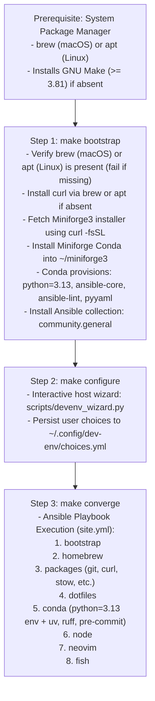

# dev-env

Your development environment, owned by this repository.

`fish`, `neovim`, `conda`, `nvm`/node, and the CLI tooling around them are declared here and converged onto the machine.
The machine is not the source of truth — this repo is.

---

## Tool Chain & Execution Order

The environment enforces a pure `make -> conda -> ansible` toolchain hierarchy:



### Stage-by-Stage Execution

| Stage                              | Command          | Primary Tool                        | Purpose                                                                                                  | Output / State                                                      |
| ---------------------------------- | ---------------- | ----------------------------------- | -------------------------------------------------------------------------------------------------------- | ------------------------------------------------------------------- |
| **Prerequisite**                   | `System Setup`   | `brew` (macOS) or `apt` (Linux)     | System package manager (installs `make`, `curl`, and host packages)                                      | `brew` or `apt` on host                                             |
| **Stage 0: Prerequisite Probe**    | `make check`     | POSIX shell in `make`               | Read-only check of `GNU Make`, `OS`, `brew`/`apt`, `Conda`, and `Ansible`                                | Status report (never mutates system; fails if `brew`/`apt` missing) |
| **Stage 1: Ansible Bootstrap**     | `make bootstrap` | `GNU Make` + `brew`/`apt` + `Conda` | Verify `brew`/`apt`, install `curl` if absent, fetch Miniforge Conda, install Ansible and Python tooling | `~/miniforge3`, `~/.local/share/dev-env/collections/`               |
| **Stage 2: Interactive Wizard**    | `make configure` | Conda Python                        | Interactive host setup and dotfile conflict resolution                                                   | `~/.config/dev-env/choices.yml`                                     |
| **Stage 3: Whole-System Converge** | `make converge`  | `ansible-playbook`                  | Converge packages, Stow dotfiles, runtimes, and plugins                                                  | Fully converged system                                              |

---

## Repository Setup & Worktree Architecture

This repository is designed to be cloned as a bare repository with Git worktrees, allowing multiple branches to be
checked out simultaneously without interfering with active development:

```bash
git clone --bare <repo-url> dev-env/.git
git --git-dir=dev-env/.git config remote.origin.fetch "+refs/heads/*:refs/remotes/origin/*"
git --git-dir=dev-env/.git fetch origin
git --git-dir=dev-env/.git worktree add dev-env/main main
```

Worktree directory layout:

- `dev-env/.git` (central Git database)
- `dev-env/main` (canonical checkout worktree)
- `dev-env/<worktree>` (isolated intent or feature worktrees)

---

## Commands & Workflow

### Quick Start (New Machine)

```bash
make check        # Read-only prerequisite probe (never modifies system)
make bootstrap    # Provision Conda, Python 3.13, Ansible, and collections
make configure    # Interactive wizard: select variants & resolve conflicts
make install      # Full pipeline: check -> bootstrap -> configure -> converge
```

### Day-to-Day Operations

```bash
make converge       # Full system converge (ansible-playbook site.yml --diff)
make check-mode     # Dry run: preview changes without modifying system
make doctor         # Idempotence probe: dry run diff + repo integrity check
make dotfiles       # Re-link managed dotfiles via GNU Stow (--no-folding)
make nvim-sync      # Sync Neovim plugins at locked revisions
make fisher         # Sync fish plugins via fisher
make probe-packages # Package installation dry run for detected OS
make facts          # Display resolved platform facts and package list
make login-shell    # Make fish the default login shell (prompts for password)
make unlink         # Reversible teardown of managed symlinks (CONFIRM=yes)
make test           # Run unit tests via pytest (manifest & templating invariants)
make test-all       # Run all tests including network asset checks
make docs-fmt       # Format markdown documentation using Prettier
```

---

## Package & Tool Inventory

### 1. Core CLI Packages (`devenv_packages_core`)

All 22 core packages defined in `ansible/group_vars/all.yml`:

| Logical Package | macOS (`brew`) Formula | Linux (`apt`) Package | Stow Status             | Description                                                |
| --------------- | ---------------------- | --------------------- | ----------------------- | ---------------------------------------------------------- |
| `aria2`         | `aria2`                | `aria2`               | Binary                  | High-speed multi-protocol download utility                 |
| `autossh`       | `autossh`              | `autossh`             | Binary                  | Automatically restarts SSH sessions and tunnels            |
| `curl`          | `curl`                 | `curl`                | Binary                  | Command-line tool for transferring data with URLs          |
| `delta`         | `delta`                | `git-delta`           | Binary                  | Syntax-highlighting pager for git diffs                    |
| `fd`            | `fd`                   | `fd-find`             | Binary                  | Fast, user-friendly alternative to `find`                  |
| `fish`          | `fish`                 | `fish`                | Stow package (`fish`)   | Smart and user-friendly command line shell                 |
| `fzf`           | `fzf`                  | `fzf`                 | Binary                  | General-purpose command-line fuzzy finder                  |
| `gh`            | `gh`                   | `gh`                  | Binary                  | GitHub official command-line tool                          |
| `git`           | `git`                  | `git`                 | Binary                  | Fast, scalable distributed version control system          |
| `htop`          | `htop`                 | `htop`                | Binary                  | Interactive process viewer and system monitor              |
| `iperf3`        | `iperf3`               | `iperf3`              | Binary                  | Network bandwidth measurement tool                         |
| `jq`            | `jq`                   | `jq`                  | Binary                  | Lightweight and flexible command-line JSON processor       |
| `ncdu`          | `ncdu`                 | `ncdu`                | Binary                  | NCurses disk usage analyzer                                |
| `neovim`        | `neovim`               | `neovim`              | Stow package (`nvim-*`) | Hyperextensible Vim-based text editor                      |
| `openssh`       | `openssh`              | `openssh-client`      | Binary                  | OpenSSH secure connectivity client suite                   |
| `ripgrep`       | `ripgrep`              | `ripgrep`             | Binary                  | Line-oriented search tool respecting gitignore             |
| `rsync`         | `rsync`                | `rsync`               | Binary                  | Fast, versatile file copying and synchronization tool      |
| `stow`          | `stow`                 | `stow`                | Binary                  | Symlink farm manager for dotfiles packages                 |
| `tmux`          | `tmux`                 | `tmux`                | Stow package (`tmux`)   | Terminal multiplexer (XDG path `~/.config/tmux/tmux.conf`) |
| `tree`          | `tree`                 | `tree`                | Binary                  | Recursive directory listing visualizer                     |
| `unzip`         | `(OS-provided)`        | `unzip`               | Binary                  | Extraction utility for zip archives (skipped in brew)      |
| `watch`         | `watch`                | `procps`              | Binary                  | Periodic command execution monitor (`procps` on Debian)    |

### 2. Language Runtimes & Conda Tools

- **Python Runtime:** `CPython 3.13` provisioned via `Miniforge3` into `~/miniforge3`.
- **Conda Tools (`devenv_conda_tools`):**
  - `uv`: Extremely fast Python package manager and resolver installed via Conda.
  - `ruff`: Fast Python linter and code formatter installed via Conda.
  - `pre-commit`: Multi-language pre-commit hook orchestrator installed via Conda.
- **Node.js Runtime:** Pinned default version `22.23.2` managed via `nvm.fish` (declared in
  `dotfiles/fish/.config/fish/conf.d/00-devenv.fish`).

### 3. GNU Stow Packages & Config Variants (`devenv_package_variants`)

Dotfiles are managed via GNU Stow with the `--no-folding` flag, keeping leaf configuration symlinked while directories
remain real local folders:

- `dotfiles/bash/`: `.bashrc`, `.bash_profile` (with `.local` override hooks)
- `dotfiles/conda/`: `.condarc` (strict conda-forge channel configuration)
- `dotfiles/fish/`: `config.fish`, `fish_plugins`, `conf.d/00-devenv.fish`
- `dotfiles/tmux/`: `~/.config/tmux/tmux.conf`
- `dotfiles/zsh/`: `.zshrc` (with `.local` override hooks)
- **Neovim Multi-Variant Packages (`devenv_package_variants.nvim`):**
  - `nvim-kickstart` (`dotfiles/nvim-kickstart/`): Full Kickstart.nvim configuration with `vim.pack`, LSP, Treesitter,
    and locked plugin revisions. Default variant.
  - `nvim-minimal` (`dotfiles/nvim-minimal/`): Lightweight, blazing fast Neovim configuration using built-in settings
    and standard keymaps.
  - `nvim-lazyvim` (`dotfiles/nvim-lazyvim/`): LazyVim starter distribution configuration with structured plugin
    imports.

### 4. Fish Shell Plugins (`fish_plugins`)

Managed by `fisher`:

1. `jorgebucaran/fisher`: Fish plugin manager.
2. `reitzig/sdkman-for-fish@v2.1.0`: Fish shell integration for SDKMAN.
3. `jorgebucaran/nvm.fish`: Node.js version manager wrapper for Fish.

### 5. Neovim Plugins (`nvim-pack-lock.json`)

All 26 plugins managed via `vim.pack` and locked to explicit commit hashes:

1. `LuaSnip` (`https://github.com/L3MON4D3/LuaSnip`)
2. `blink.cmp` (`https://github.com/saghen/blink.cmp`)
3. `conform.nvim` (`https://github.com/stevearc/conform.nvim`)
4. `diffview.nvim` (`https://github.com/sindrets/diffview.nvim`)
5. `fidget.nvim` (`https://github.com/j-hui/fidget.nvim`)
6. `fzf-lua` (`https://github.com/ibhagwan/fzf-lua`)
7. `gitsigns.nvim` (`https://github.com/lewis6991/gitsigns.nvim`)
8. `guess-indent.nvim` (`https://github.com/NMAC427/guess-indent.nvim`)
9. `mason-lspconfig.nvim` (`https://github.com/mason-org/mason-lspconfig.nvim`)
10. `mason-tool-installer.nvim` (`https://github.com/WhoIsSethDaniel/mason-tool-installer.nvim`)
11. `mason.nvim` (`https://github.com/mason-org/mason.nvim`)
12. `mini.completion` (`https://github.com/nvim-mini/mini.completion`)
13. `mini.nvim` (`https://github.com/nvim-mini/mini.nvim`)
14. `neo-tree.nvim` (`https://github.com/nvim-neo-tree/neo-tree.nvim`)
15. `nui.nvim` (`https://github.com/MunifTanjim/nui.nvim`)
16. `nvim-lspconfig` (`https://github.com/neovim/nvim-lspconfig`)
17. `nvim-treesitter` (`https://github.com/nvim-treesitter/nvim-treesitter`)
18. `plenary.nvim` (`https://github.com/nvim-lua/plenary.nvim`)
19. `quicker.nvim` (`https://github.com/stevearc/quicker.nvim`)
20. `render-markdown.nvim` (`https://github.com/MeanderingProgrammer/render-markdown.nvim`)
21. `telescope-fzf-native.nvim` (`https://github.com/nvim-telescope/telescope-fzf-native.nvim`)
22. `telescope-ui-select.nvim` (`https://github.com/nvim-telescope/telescope-ui-select.nvim`)
23. `telescope.nvim` (`https://github.com/nvim-telescope/telescope.nvim`)
24. `todo-comments.nvim` (`https://github.com/folke/todo-comments.nvim`)
25. `tokyonight.nvim` (`https://github.com/folke/tokyonight.nvim`)
26. `which-key.nvim` (`https://github.com/folke/which-key.nvim`)

### 6. macOS GUI Casks & Purged Unmanaged Packages

- **GUI Casks (`devenv_casks`):** `docker-desktop` (installed when `devenv_install_gui_casks: true`).
- **Purged Duplicate Packages (`devenv_packages_remove`):** `nvm`, `node` (purged when `devenv_remove_unmanaged: true`
  to prevent conflicts with `nvm.fish`).

---

## Interactive Wizard & Conflict Resolution

Run `make configure` (or let `make install` launch it on interactive TTYs) to execute `scripts/devenv_wizard.py`.

The wizard guides you through five sequential steps:

1. **Step A (Platform Confirmation):** Inspects host platform and confirms package backend (`brew` or `apt`).
2. **Step B (Stow Package & Variant Selection):** Selects active Stow packages and chooses your Neovim distribution
   (`kickstart`, `minimal`, or `lazyvim`).
3. **Step C (Dotfile Conflict Resolution):** Compares repo files with existing `$HOME` files. For any differing file,
   you are prompted:
   - `[d]` **Diff:** Displays colorized or unified diff (`delta` / `diff -u`).
   - `[m]` **Merge:** Launches an interactive three-way merge in `$EDITOR -d` (`nvim -d`), backing up the original.
   - `[l]` **Local Override:** Extracts your personal custom lines to `.local` override files (`~/.bashrc.local`,
     `~/.zshrc.local`, `~/.config/fish/conf.d/99-local.fish`).
   - `[a]` **Adopt:** Adopts the local file into the repository's package directory, backing up the original.
   - `[b]` **Backup & Replace:** Backs up the local file to `~/.local/share/dev-env/backup/` and allows Stow to link the
     repo version.
   - `[s]` **Skip:** Leaves the destination untouched and appends the path to `devenv_skip_links`.
4. **Step D (Feature Flags & Runtime Pins):** Confirms login shell change to fish, GUI casks, unmanaged package removal,
   and runtime version pins.
5. **Step E (Persist Choices):** Writes configuration to `~/.config/dev-env/choices.yml`.

---

## CI/CD Pipeline

Continuous integration workflows run across macOS and Linux on GitHub Actions (`.github/workflows/`):

- **`make.yml`**: Validates GNU Make 3.81 compatibility, `make help`, and `make check`.
- **`test-hygiene.yml`**: Runs `uv lock --check`, `ruff check .`, `ansible-lint`, and Prettier markdown formatting
  checks.
- **`test-unit.yml`**: Executes test suites under `tests/` (`pytest -m "not network"`).
- **`test-network.yml`**: Validates upstream installer URLs and release assets (`DEVENV_NETWORK_TESTS=1`).
