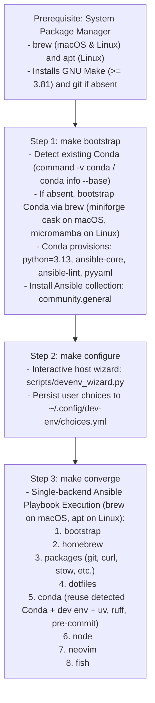

# dev-env

Your development environment, owned by this repository.

`fish` (Terminal / Shell), `neovim` (Editor / IDE), `conda` (Python runtime & package manager), `nvm` (Node.js version
manager), and the CLI tooling around them are declared here and converged onto the machine. The machine is not the
source of truth — this repo is.

---

## Getting Started

### 1. Prerequisites

- **Homebrew (`brew`)**: Required on both macOS and Linux for Conda bootstrap (and also serves as the macOS system
  package manager). If missing, install Homebrew from [brew.sh](https://brew.sh).
- **`apt`**: Required on Debian/Ubuntu Linux for system packages.
- **GNU Make & Git**: If absent on the host, install them before starting:
  - On macOS: `brew install make git` (or `xcode-select --install`).
  - On Linux: `sudo apt update && sudo apt install -y make git`.

### 2. Clone the Repository

Clone this repository as a bare repository with Git worktrees:

```bash
git clone --bare <repo-url> dev-env/.git
git --git-dir=dev-env/.git config remote.origin.fetch "+refs/heads/*:refs/remotes/origin/*"
git --git-dir=dev-env/.git fetch origin
git --git-dir=dev-env/.git worktree add dev-env/main main
cd dev-env/main
```

### 3. Kick Off the Environment (`make install`)

**`make install`** is the single command that kicks off and converges the entire dev-env pipeline:

```bash
make install
```

This sequentially executes:

1. `make check`: Verifies system prerequisites (`GNU Make`, `OS`, `brew`, `apt`, `conda`, `Ansible`).
2. `make bootstrap`: Detects existing Conda or installs it via Homebrew (`miniforge` cask on macOS, `micromamba` on
   Linux), then provisions Python 3.13, Ansible, and required collections.
3. `make configure`: Launches the interactive host wizard on fresh checkouts to configure variants and resolve dotfile
   conflicts.
4. `make converge`: Executes Ansible playbook convergence (`brew` on macOS, `apt` on Linux).

You can also run any individual stage command on demand.

---

## Tool Chain & Execution Order

The environment enforces a pure `make -> conda -> ansible` toolchain hierarchy:



### Stage-by-Stage Execution

| Stage                              | Command          | Primary Tool                         | Purpose                                                                                                     | Output / State                                                         |
| ---------------------------------- | ---------------- | ------------------------------------ | ----------------------------------------------------------------------------------------------------------- | ---------------------------------------------------------------------- |
| **Prerequisite**                   | `System Setup`   | `brew` (macOS/Linux) & `apt` (Linux) | System package managers (install `make` and `git` if absent)                                                | `brew` and/or `apt` on host                                            |
| **Stage 0: Prerequisite Probe**    | `make check`     | POSIX shell in `make`                | Read-only check of `GNU Make`, `OS`, `brew`, `apt`, `conda`, and `Ansible`                                  | Status report (never mutates system; fails if `brew` or `apt` missing) |
| **Stage 1: Ansible Bootstrap**     | `make bootstrap` | `GNU Make` + `brew` + `Conda`        | Detect existing Conda or bootstrap via `brew`, install Ansible and Python tooling                           | Active Conda environment, `~/.local/share/dev-env/collections/`        |
| **Stage 2: Interactive Wizard**    | `make configure` | Conda Python                         | Interactive host setup and dotfile conflict resolution                                                      | `~/.config/dev-env/choices.yml`                                        |
| **Stage 3: Whole-System Converge** | `make converge`  | `ansible-playbook`                   | Single-backend converge of packages (`brew` on macOS, `apt` on Linux), Stow dotfiles, runtimes, and plugins | Fully converged system                                                 |

---

## Repository Setup & Worktree Architecture

This repository is designed to be cloned as a bare repository with Git worktrees, allowing multiple branches to be
checked out simultaneously without interfering with active development:

```bash
git clone --bare <repo-url> dev-env/.git
git --git-dir=dev-env/.git config remote.origin.fetch "+refs/heads/*:refs/remotes/origin/*"
git --git-dir=dev-env/.git fetch origin
git --git-dir=dev-env/.git worktree add dev-env/main main
```

Worktree directory layout:

- `dev-env/.git` (central Git database)
- `dev-env/main` (canonical checkout worktree)
- `dev-env/<worktree>` (isolated intent or feature worktrees)

---

## Commands & Workflow

### Quick Start (New Machine)

```bash
make check        # Read-only prerequisite probe (never modifies system)
make bootstrap    # Provision Conda, Python 3.13, Ansible, and collections
make configure    # Interactive wizard: select variants & resolve conflicts
make install      # Full pipeline: check -> bootstrap -> configure -> converge
```

### Day-to-Day Operations

```bash
make converge       # Full system converge (ansible-playbook site.yml --diff)
make check-mode     # Dry run: preview changes without modifying system
make doctor         # Idempotence probe: dry run diff + repo integrity check
make dotfiles       # Re-link managed dotfiles via GNU Stow (--no-folding)
make nvim-sync      # Sync Neovim plugins at locked revisions
make fisher         # Sync fish plugins via fisher
make probe-packages # Package installation dry run for detected OS
make facts          # Display resolved platform facts and package list
make login-shell    # Make fish the default login shell (prompts for password)
make unlink         # Reversible teardown of managed symlinks (CONFIRM=yes)
make test           # Run unit tests via pytest (manifest & templating invariants)
make test-all       # Run all tests including network asset checks
make docs-fmt       # Format markdown documentation using Prettier
```

---

## Package & Tool Inventory

### 1. Core CLI Packages (`devenv_packages_core`)

All 23 core packages defined in `ansible/group_vars/all.yml`:

| Logical Package | Category                  | macOS (`brew`) Formula | Linux (`apt`) Package | Stow Status             | Description                                                |
| --------------- | ------------------------- | ---------------------- | --------------------- | ----------------------- | ---------------------------------------------------------- |
| `aria2`         | `Networking / Download`   | `aria2`                | `aria2`               | Binary                  | High-speed multi-protocol download utility                 |
| `autossh`       | `Networking / SSH`        | `autossh`              | `autossh`             | Binary                  | Automatically restarts SSH sessions and tunnels            |
| `curl`          | `Networking / HTTP`       | `curl`                 | `curl`                | Binary                  | Command-line tool for transferring data with URLs          |
| `delta`         | `Git / Diff`              | `delta`                | `git-delta`           | Binary                  | Syntax-highlighting pager for git diffs                    |
| `fd`            | `Filesystem / Search`     | `fd`                   | `fd-find`             | Binary                  | Fast, user-friendly alternative to `find`                  |
| `fish`          | `Terminal / Shell`        | `fish`                 | `fish`                | Stow package (`fish`)   | Smart and user-friendly command line shell                 |
| `fzf`           | `Terminal / Search`       | `fzf`                  | `fzf`                 | Binary                  | General-purpose command-line fuzzy finder                  |
| `gh`            | `Git / GitHub`            | `gh`                   | `gh`                  | Binary                  | GitHub official command-line tool                          |
| `git`           | `Version Control`         | `git`                  | `git`                 | Binary                  | Fast, scalable distributed version control system          |
| `go`            | `Development / Toolchain` | `go`                   | `golang-go`           | Binary                  | Go programming language runtime and toolchain              |
| `htop`          | `System Monitoring`       | `htop`                 | `htop`                | Binary                  | Interactive process viewer and system monitor              |
| `iperf3`        | `Networking / Benchmark`  | `iperf3`               | `iperf3`              | Binary                  | Network bandwidth measurement tool                         |
| `jq`            | `Data / JSON`             | `jq`                   | `jq`                  | Binary                  | Lightweight and flexible command-line JSON processor       |
| `ncdu`          | `Filesystem / Disk`       | `ncdu`                 | `ncdu`                | Binary                  | NCurses disk usage analyzer                                |
| `neovim`        | `Editor / IDE`            | `neovim`               | `neovim`              | Stow package (`nvim-*`) | Hyperextensible Vim-based text editor                      |
| `openssh`       | `Networking / SSH`        | `openssh`              | `openssh-client`      | Binary                  | OpenSSH secure connectivity client suite                   |
| `ripgrep`       | `Filesystem / Search`     | `ripgrep`              | `ripgrep`             | Binary                  | Line-oriented search tool respecting gitignore             |
| `rsync`         | `Filesystem / Sync`       | `rsync`                | `rsync`               | Binary                  | Fast, versatile file copying and synchronization tool      |
| `stow`          | `Dotfiles / Symlinks`     | `stow`                 | `stow`                | Binary                  | Symlink farm manager for dotfiles packages                 |
| `tmux`          | `Terminal / Multiplexer`  | `tmux`                 | `tmux`                | Stow package (`tmux`)   | Terminal multiplexer (XDG path `~/.config/tmux/tmux.conf`) |
| `tree`          | `Filesystem / Navigation` | `tree`                 | `tree`                | Binary                  | Recursive directory listing visualizer                     |
| `unzip`         | `Archive / Compression`   | `(OS-provided)`        | `unzip`               | Binary                  | Extraction utility for zip archives (skipped in brew)      |
| `watch`         | `System Monitoring`       | `watch`                | `procps`              | Binary                  | Periodic command execution monitor (`procps` on Debian)    |

### 2. Language Runtimes & Conda Tools

| Tool / Runtime                 | Category / Language                                             | Provisioned Via                         | Description                                                            |
| ------------------------------ | --------------------------------------------------------------- | --------------------------------------- | ---------------------------------------------------------------------- |
| `CPython 3.13` / `conda`       | **Python — Runtime & Environment Manager**                      | Detected Conda / Miniforge / Micromamba | Python language runtime and Conda environment manager                  |
| `uv`                           | **Python — Package & Project Manager**                          | Conda (`conda-forge`)                   | Extremely fast Python package manager and resolver installed via Conda |
| `ruff`                         | **Python — Linter & Formatter**                                 | Conda (`conda-forge`)                   | Fast Python linter and code formatter installed via Conda              |
| `pre-commit`                   | **Multi-Language — Git Hooks**                                  | Conda (`conda-forge`)                   | Multi-language pre-commit hook orchestrator installed via Conda        |
| `nvm.fish` + `Node.js 26.13.1` | **JavaScript / TypeScript — Node.js Runtime & Version Manager** | `nvm.fish` (via `fisher`)               | Node.js version manager and runtime pinned in `00-devenv.fish`         |

### 3. GNU Stow Packages & Config Variants (`devenv_package_variants`)

Dotfiles are managed via GNU Stow with the `--no-folding` flag, keeping leaf configuration symlinked while directories
remain real local folders:

- `dotfiles/bash/` (**Terminal / Shell (Bash)**): `.bashrc`, `.bash_profile` (with `.local` override hooks)
- `dotfiles/conda/` (**Python (Conda)**): `.condarc` (strict conda-forge channel configuration)
- `dotfiles/fish/` (**Terminal / Shell (Fish)**): `config.fish`, `fish_plugins`, `conf.d/00-devenv.fish`
- `dotfiles/tmux/` (**Terminal / Multiplexer (tmux)**): `~/.config/tmux/tmux.conf`
- `dotfiles/zsh/` (**Terminal / Shell (Zsh)**): `.zshrc` (with `.local` override hooks)
- **Neovim Multi-Variant Packages (`devenv_package_variants.nvim`)** (**Editor / IDE (Neovim / Lua)**):
  - `nvim-kickstart` (`dotfiles/nvim-kickstart/`): Full Kickstart.nvim configuration with `vim.pack`, LSP, Treesitter,
    and locked plugin revisions. Default variant.
  - `nvim-minimal` (`dotfiles/nvim-minimal/`): Lightweight, blazing fast Neovim configuration using built-in settings
    and standard keymaps.
  - `nvim-lazyvim` (`dotfiles/nvim-lazyvim/`): LazyVim starter distribution configuration with structured plugin
    imports.

### 4. Fish Shell Plugins (`fish_plugins`)

Managed by `fisher`:

1. `jorgebucaran/fisher` (**Terminal / Shell**): Fish plugin manager.
2. `reitzig/sdkman-for-fish@v2.1.0` (**Java / JVM**): Fish shell integration for SDKMAN.
3. `jorgebucaran/nvm.fish` (**JavaScript / Node.js**): Node.js version manager wrapper for Fish.

### 5. Neovim Plugins (`nvim-pack-lock.json`)

All 25 plugins managed via `vim.pack` and locked to explicit commit hashes (**Editor / IDE (Neovim / Lua)**):

1. `LuaSnip` (**Editor / IDE (Neovim / Lua) — Snippets**): `https://github.com/L3MON4D3/LuaSnip`
2. `blink.cmp` (**Editor / IDE (Neovim / Lua) — Completion**): `https://github.com/saghen/blink.cmp`
3. `conform.nvim` (**Editor / IDE (Neovim / Lua) — Formatting**): `https://github.com/stevearc/conform.nvim`
4. `fidget.nvim` (**Editor / IDE (Neovim / Lua) — UI / LSP Progress**): `https://github.com/j-hui/fidget.nvim`
5. `gitsigns.nvim` (**Editor / IDE (Neovim / Lua) — Git Signs**): `https://github.com/lewis6991/gitsigns.nvim`
6. `guess-indent.nvim` (**Editor / IDE (Neovim / Lua) — Indentation**): `https://github.com/NMAC427/guess-indent.nvim`
7. `indent-blankline.nvim` (**Editor / IDE (Neovim / Lua) — Indent Guides**):
   `https://github.com/lukas-reineke/indent-blankline.nvim`
8. `mason-lspconfig.nvim` (**Editor / IDE (Neovim / Lua) — LSP Management**):
   `https://github.com/mason-org/mason-lspconfig.nvim`
9. `mason-tool-installer.nvim` (**Editor / IDE (Neovim / Lua) — Tool Installer**):
   `https://github.com/WhoIsSethDaniel/mason-tool-installer.nvim`
10. `mason.nvim` (**Editor / IDE (Neovim / Lua) — Package Manager**): `https://github.com/mason-org/mason.nvim`
11. `mini.nvim` (**Editor / IDE (Neovim / Lua) — Utility Library**): `https://github.com/nvim-mini/mini.nvim`
12. `neo-tree.nvim` (**Editor / IDE (Neovim / Lua) — File Explorer**): `https://github.com/nvim-neo-tree/neo-tree.nvim`
13. `nui.nvim` (**Editor / IDE (Neovim / Lua) — UI Component Library**): `https://github.com/MunifTanjim/nui.nvim`
14. `nvim-autopairs` (**Editor / IDE (Neovim / Lua) — Autopairs**): `https://github.com/windwp/nvim-autopairs`
15. `nvim-lint` (**Editor / IDE (Neovim / Lua) — Linter**): `https://github.com/mfussenegger/nvim-lint`
16. `nvim-lspconfig` (**Editor / IDE (Neovim / Lua) — LSP Client**): `https://github.com/neovim/nvim-lspconfig`
17. `nvim-treesitter` (**Editor / IDE (Neovim / Lua) — Syntax Highlighting**):
    `https://github.com/nvim-treesitter/nvim-treesitter`
18. `plenary.nvim` (**Editor / IDE (Neovim / Lua) — Lua Utility Functions**): `https://github.com/nvim-lua/plenary.nvim`
19. `telescope-fzf-native.nvim` (**Editor / IDE (Neovim / Lua) — Fuzzy Search Native**):
    `https://github.com/nvim-telescope/telescope-fzf-native.nvim`
20. `telescope-ui-select.nvim` (**Editor / IDE (Neovim / Lua) — UI Selection**):
    `https://github.com/nvim-telescope/telescope-ui-select.nvim`
21. `telescope.nvim` (**Editor / IDE (Neovim / Lua) — Fuzzy Finder**):
    `https://github.com/nvim-telescope/telescope.nvim`
22. `todo-comments.nvim` (**Editor / IDE (Neovim / Lua) — Highlight Comments**):
    `https://github.com/folke/todo-comments.nvim`
23. `tokyonight.nvim` (**Editor / IDE (Neovim / Lua) — Colorscheme**): `https://github.com/folke/tokyonight.nvim`
24. `vim-tmux-navigator` (**Editor / IDE (Neovim / Lua) — Tmux Navigation**):
    `https://github.com/christoomey/vim-tmux-navigator`
25. `which-key.nvim` (**Editor / IDE (Neovim / Lua) — Keybinding Popup**): `https://github.com/folke/which-key.nvim`

### 6. macOS GUI Casks & Purged Unmanaged Packages

- **GUI Casks (`devenv_casks`):** `docker-desktop` (**Containers / Virtualization**) — installed when
  `devenv_install_gui_casks: true`.
- **Purged Duplicate Packages (`devenv_packages_remove`):** `nvm`, `node` (**JavaScript / Node.js**) — purged when
  `devenv_remove_unmanaged: true` to prevent conflicts with `nvm.fish`.

---

## Interactive Wizard & Conflict Resolution

Run `make configure` (or let `make install` launch it on interactive TTYs) to execute `scripts/devenv_wizard.py`.

The wizard guides you through five sequential steps:

1. **Step A (Platform Confirmation):** Inspects host platform and confirms package backend (`brew` or `apt`).
2. **Step B (Stow Package & Variant Selection):** Selects active Stow packages and chooses your Neovim distribution
   (`kickstart`, `minimal`, or `lazyvim`).
3. **Step C (Dotfile Conflict Resolution):** Compares repo files with existing `$HOME` files. For any differing file,
   you are prompted:
   - `[d]` **Diff:** Displays colorized or unified diff (`delta` / `diff -u`).
   - `[m]` **Merge:** Launches an interactive three-way merge in `$EDITOR -d` (`nvim -d`), backing up the original.
   - `[l]` **Local Override:** Extracts your personal custom lines to `.local` override files (`~/.bashrc.local`,
     `~/.zshrc.local`, `~/.config/fish/conf.d/99-local.fish`).
   - `[a]` **Adopt:** Adopts the local file into the repository's package directory, backing up the original.
   - `[b]` **Backup & Replace:** Backs up the local file to `~/.local/share/dev-env/backup/` and allows Stow to link the
     repo version.
   - `[s]` **Skip:** Leaves the destination untouched and appends the path to `devenv_skip_links`.
4. **Step D (Feature Flags & Runtime Pins):** Confirms login shell change to fish, GUI casks, unmanaged package removal,
   and runtime version pins.
5. **Step E (Persist Choices):** Writes configuration to `~/.config/dev-env/choices.yml`.

---

## CI/CD Pipeline

Continuous integration workflows run across macOS and Linux on GitHub Actions (`.github/workflows/`):

- **`make.yml`**: Validates GNU Make 3.81 compatibility, `make help`, and `make check`.
- **`test-hygiene.yml`**: Runs `uv lock --check`, `ruff check .`, `ansible-lint`, and Prettier markdown formatting
  checks.
- **`test-unit.yml`**: Executes test suites under `tests/` (`pytest -m "not network"`).
- **`test-network.yml`**: Validates upstream installer URLs and release assets (`DEVENV_NETWORK_TESTS=1`).
